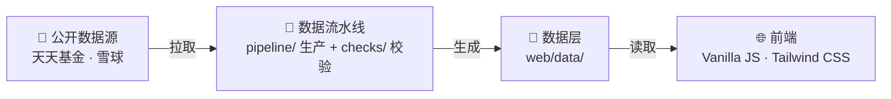

# US Fund Tracker · 美股基金追踪看板

美股 QDII 基金追踪看板。纯静态部署，零后端。**🤖 Agent 模式开箱即用**（Codex 自动读 AGENTS.md + docs/）。

🌐 **在线看板**：<https://zhouminghan.github.io/qdii-tracker/>
📦 **源码仓库**：<https://github.com/zhouminghan/qdii-tracker>

[](https://github.com/zhouminghan/qdii-tracker/actions/workflows/update-data.yml)
[](https://github.com/zhouminghan/qdii-tracker/blob/main/LICENSE)

## ✨ 核心功能

- **五大一级 Tab**：🏦 QDII 追踪 · 🌐 全球行情 · 📊 纳指图谱 · 📚 投资知识 · 💼 我的资产（默认 QDII，支持 hash 深链、刷新/分享与浏览器前进/后退）
- **🌐 全球行情**：宏观利率（美元/离岸人民币 + 美债 2/10/30 年 + VIX + 纳指 PE）→ 全球指数宫格 → 科技七姐妹 → 外汇汇率（按基础货币分组）→ 黄金多市场（折算/溢价/品牌金价）
- **📊 纳指图谱**：1986 至今年度涨跌幅 / 年内最大回撤 / 谷值分布、年度·月度热力图切换、多周期月份排行、CNN 恐慌贪婪 + VIX & PE 阶梯定投
- **🏦 QDII 追踪**：场外/场内一键切换，申购状态/限额/费率列表，溢价警示与站内搜索
- **💼 我的资产**：本地录入持仓与交易流水，自动估算市值、盈亏与配比（数据仅存浏览器）
- **📚 投资知识**：场内 vs 场外、A/C 类份额、LOF 套利、QDII 选基、纳指 ETF 溢价成因，按子分类筛选
- **🎨 主题与配色**：深浅双主题 + 红涨绿跌/绿涨红跌一键切换
- **📸 分享与导出**：场外/场内截图分享（7 风格 × 3 布局）、纳指图谱长图与海报导出
- **📈 历史走势图**：指数/外汇/黄金/个股可点击弹窗看日 K，9 档区间，Crosshair 悬停交互
- **纯静态首屏**：本地 JSON 零外部请求，按需加载实时数据
- **智能轮询**：5 档分时调度，Settled 自动停止，页面隐藏自动暂停

## 🏗️ 架构



> 纯 GitHub Pages 静态托管，无后端、无数据库、无 Docker。

## 📂 目录

<!-- DOCSYNC START: tree -->
```text
qdii-tracker/
├── .github/    # CI 工作流（deploy-pages / update-data / ci）
│   └── workflows/
├── .githooks/    # 本地 git hooks（pre-commit doc_sync + pre-push 门禁）
│   ├── pre-commit
│   └── pre-push
├── scripts/    # 数据流水线（Python）
│   ├── checks/
│   ├── core/
│   ├── pipeline/
│   ├── sources/
│   ├── fundctl.py
│   ├── requirements-dev.txt
│   ├── requirements-ui.txt
│   ├── requirements.txt
│   └── setup_hooks.sh
├── config/    # 基金分类 SSOT 配置
│   └── funds.json
├── web/    # 前端（纯静态）
│   ├── css/
│   ├── data/
│   ├── js/
│   ├── .nojekyll
│   ├── feed.rss
│   ├── icon.svg
│   ├── index.html
│   ├── manifest.json
│   ├── robots.txt
│   ├── sitemap.xml
│   └── sw.js
├── docs/    # 人读文档 — 踩坑 / 架构
│   ├── architecture.md
│   └── gotchas.md
├── test/    # 测试与 UI 回归（pytest + Playwright）
│   ├── ui_scenarios/
│   ├── run_ui_scenarios.py
│   ├── test_akshare_source.py
│   ├── test_brand_gold.py
│   ├── test_classify.py
│   ├── test_cnn_sentiment.py
│   ├── test_dca_strategy.py
│   ├── test_gold.py
│   ├── test_kline_history.py
│   ├── test_market_temperature.py
│   ├── test_nasdaq_history.py
│   ├── test_nav_history.py
│   ├── test_premium_history.py
│   ├── test_purchase_history.py
│   ├── test_ths_source.py
│   └── test_utils.py
├── .gitignore
├── AGENTS.md
├── LICENSE
└── README.md
```
<!-- DOCSYNC END: tree -->

Agent 规则详见 [AGENTS.md](./AGENTS.md)。

## 🚀 部署（GitHub Pages）

1. 创建 Public 仓库，推送代码
2. Settings → Pages → Source: `GitHub Actions`
3. Settings → Actions → Workflow permissions: `Read and write`
4. Actions → Run workflow 验证 → 访问 `https://{user}.github.io/qdii-tracker/`

日常：打开网页即可。想立刻更新 → Actions → Run workflow。

## 💻 本地开发

```bash
cd scripts && pip install -r requirements.txt
./scripts/setup_hooks.sh                      # 启用本地 git hooks（pre-commit + pre-push，一次性）
python3 fundctl.py sync                       # 全量同步
python3 fundctl.py check --agent-rules        # 门禁 + Agent 规则 + 文档同步
python3 fundctl.py check --offline            # 断网/CI 时跳过 Layer 6 跨源验证
cd ../web && python3 -m http.server 8765      # 本地开发
```

日常维护命令（由 `doc_sync.py` 自动生成，请勿手改）：

<!-- DOCSYNC START: commands -->
```bash
python3 fundctl.py add          # 新增/强制纳入一只基金
python3 fundctl.py move         # 移动分类
python3 fundctl.py brand        # 设置公司品牌 logo 文字
python3 fundctl.py remove       # 删除一只基金（从配置和数据中移除）
python3 fundctl.py refresh      # 增量刷新
python3 fundctl.py sync         # 全量同步
python3 fundctl.py nasdaq       # 刷新纳指 40 年历史图谱数据
python3 fundctl.py sentiment    # 刷新 CNN 恐慌贪婪指数
python3 fundctl.py diagnose     # 诊断数据异常
python3 fundctl.py check        # 一致性校验
python3 fundctl.py probe        # 数据源适配层探针（导入级）
```
<!-- DOCSYNC END: commands -->

```bash
cd scripts && python3 checks/doc_sync.py --fix   # 手动文档同步

# UI 回归（仅本地跑；云端 CI 不跑，避免每次下载 Chromium）
pip install -r scripts/requirements-ui.txt       # 一次性
python -m playwright install chromium            # 一次性（约 94MB）
python test/run_ui_scenarios.py                  # 跑 6 条浏览器回归场景
```

## 📜 License

[MIT License](./LICENSE)。数据仅聚合公开信息展示，不构成投资建议。
