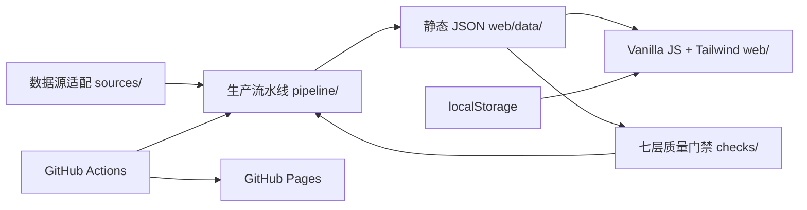

# 仓库审计（2026-11-14）

## 当前架构

Python 分为 `sources/ -> pipeline/ -> checks/`，职责边界基本清楚，数据门禁、黄金样例、离线快照和定时更新链路已成形。前端没有构建过程，HTML、全局变量、DOM 拼接、事件绑定和业务状态集中在 `main.js`，并有大量模块通过 `window.STATE` 互相通信。

## 数据流

1. `fundctl.py` 或 Actions 调用 `pipeline/*` 更新分类基金与市场数据。
2. `checks/build_snapshot.py` 生成扁平快照、首屏离线行情和 RSS。
3. 浏览器读取 `web/data/*.json`，Vanilla JS 直接操作 DOM。
4. Portfolio 目前写入 `localStorage`；研究笔记没有独立持久化模块。
5. `fundctl.py check` 执行数据、结构、fixture、申购语义、文档及可选跨源校验。

## 主要职责与规模

| 模块 | 当前职责 | 风险 |
|------|----------|------|
| `web/js/main.js` | 数据加载、状态、表格、筛选、排序、路由、搜索、详情入口 | 1,346 行单文件，职责过宽 |
| `web/js/portfolio.js` | 本地持久化、计算、表单、交易、渲染 | 675 行，localStorage 无版本迁移 |
| `web/css/app.css` | 全站样式、组件、明暗主题、响应式、截图样式 | 2,660 行，覆盖关系难追踪 |
| `web/index.html` | 全站 DOM、知识内容、弹窗、模块入口 | 916 行，内容与交互耦合 |
| `scripts/pipeline/*` | 数据生产 | 稳定，应保留并渐进整理 |
| `scripts/checks/*` | 数据质量 | 覆盖较强，缺少公共前端契约测试 |

## 业务清单

- 基金：场外/场内切换、分类筛选、跨分类搜索、多字段排序、缺失值处理、系列展开、A/C 份额、收藏、申购状态历史、费率、CSV、分享、详情、持仓、历史走势。
- 市场：全球指数、科技公司、汇率、黄金、宏观利率、纳指历史热力图、市场温度、恐慌贪婪、阶梯定投。
- 个人资产：现金、持仓、成本、市值、盈亏、配比、交易流水、编辑和删除。
- 知识：场内/场外、A/C 份额、LOF、选基、溢价、汇率、限购、指数基础内容。
- 全局：明暗主题、涨跌配色、hash 深链、北京时间和移动布局。

## 技术债

1. 前端无类型、无模块边界、无构建，跨模块依赖依赖全局对象。
2. 表格、筛选和排序与 DOM 字符串强耦合，难以建立行为级单测。
3. 个人数据只有 `localStorage`，缺少 schema 版本、事务、导入校验与恢复事务。
4. 公共 JSON 只有部分文件包含 `schema_version`，消费端没有统一 envelope。
5. UI 无组件测试、视觉回归和 axe 检查，旧浏览器场景只覆盖少量选择器。
6. 文档目录、前端文件清单和命令仍以 Vanilla 结构为假设。

## 风险

| 风险 | 影响 | 处理 |
|------|------|------|
| 迁移改变净值排序或申购语义 | 用户误判基金 | 提取纯函数并做旧行为映射测试 |
| 本地资产数据丢失 | 不可恢复的个人损失 | Dexie 版本迁移、事务恢复、JSON 备份 |
| 图表依赖增大首屏 | 移动端变慢 | ECharts 按需注册、页面懒加载 |
| 公共数据契约漂移 | 前端空白或误读 | Python 生成 catalog 并校验 TS 契约 |
| GitHub Pages 子路径错误 | 线上资源 404 | `base: './'` 与生产构建 smoke test |

## 测试覆盖

现状有 Python 数据/分类/流水线测试和 Playwright 选择器回归。缺少前端纯函数、Vue 组件、IndexedDB 迁移、数据契约、视觉快照和可访问性自动化。

## 迁移映射

| 旧实现 | 新归属 |
|--------|--------|
| `main.js` 数据加载 | `shared/infrastructure` + Pinia store |
| `main.js` 表格/筛选/排序 | `features/funds` + TanStack Table |
| `main.js` 详情/走势入口 | `features/funds` drawer + ECharts |
| 市场模块 | `pages/MarketPage` + 共享指标组件 |
| `portfolio.js` | `features/portfolio` + Dexie repository |
| 知识内容 | `pages/ResearchPage` + 本地研究数据 |
| 全局主题/hash 路由 | app shell + Vue Router + settings store |

## 审计结论

数据工程可以保留，重点重构前端和本地数据层。新实现必须与旧行为做映射，不重写基金计算口径。
